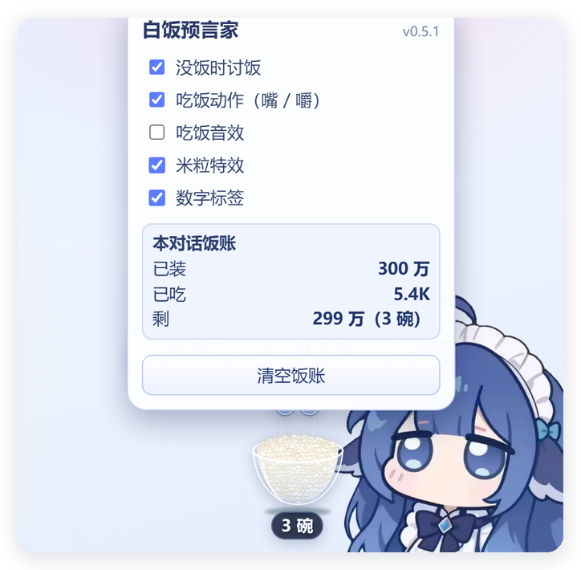

# 白饭预言家 · dsh-whale-ricebowl

给 **DSH 小鲸鱼记账挂件**（`dsh-whale-widget`）加一层「装饭喂鱼」的独立附加插件。

> **先给大肥鱼装饭（1 碗 = 100 万 token），每轮对话按真实消耗吃掉米饭；吃完它会自己讨饭。**

不改挂件本体、不做饱食度养成、不自动装饭。**没装宿主挂件时本插件不显示任何东西。**


吃饭动作特写（鲸鱼立绘 = 宿主默认角色图）：咧嘴笑 + 一颗小虎牙，木勺舀饭 → 饭团飞进嘴 → 合嘴咀嚼：


| 装饭菜单 | 每轮报账 |
| --- | --- |
|  |  |

| 没饭了会讨饭 | 设置里的「本对话饭账」 |
| --- | --- |
|  |  |

> 截图为本地 `npm run demo` 预览，鲸鱼立绘直接取自宿主插件 `dsh-whale-widget` 的默认角色图（仅用于演示，本包不打包任何上游素材）。真实使用时叠加在「小鲸鱼记账挂件」旁。

---

## 它是什么 / 不是什么

| | 说明 |
| --- | --- |
| 宿主 | 「DSH 小鲸鱼记账挂件」`dsh-whale-widget`（右下角余额鲸鱼）。本插件是它的附加层，不是替代品。 |
| 玩法 | 每个对话有自己的一锅饭：点碗装 1 / 2 / 5 碗（1 碗 = 100 万 token）；每轮对话按真实 token 消耗吃米饭；每轮结束气泡报账「这轮吃了多少 · 还剩多少」；剩 0 时自动讨饭。 |
| 画面 | 透明玻璃碗装着**一整块煮熟的米饭**（米粒只是表面纹理）；主碗 + 最多 4 个碗位显示总库存（最多 5 碗，超过继续记账、UI 不变）。吃饭时鲸鱼**咧嘴（一颗小虎牙）**、木勺舀饭、饭团飞进嘴里、嚼两下，配更可爱的舀饭 / 碰碗 / 咀嚼音效（WebAudio 现场合成）。 |
| 记录 | 每个对话（DSH session）独立记账：已装 / 已吃 / 剩余；切换对话各吃各的；刷新页面保留。 |
| 不是 | 不是饱食度养成、不做等级/记忆、不自动估算、不读对话内容、不联网上传。 |

和已有的同类插件 `dsh-whale-food-expack`（喂饭 + 饱食度养成）相比：它做「养宠物」，本插件做「装饭—吃饭—报账—讨饭」。**两者都会在鲸鱼旁摆碗，建议只装一个**；同时装了会检测并提示。

## 依赖与安装

**前置**：DSH 0.2.x（在 0.2.0-rc.2 实测）与「DSH 小鲸鱼记账挂件」`dsh-whale-widget@^0.4.2`：

```bash
dsh plugin --profile web add dsh-whale-widget
```

### 从 GitHub 安装（当前推荐，npm 还没发）

```bash
dsh plugin --profile web add github:LuChen0820/dsh-whale-ricebowl
```

### 从 npm 安装（发布后）

```bash
dsh plugin --profile web add dsh-whale-ricebowl
```

### 从本地目录安装（开发版）

```bash
dsh plugin --profile web add link:C:/path/to/dsh-whale-ricebowl
```

### 官方桌面端（Electron）

桌面端的 index.html 由安装包静态直出，`tapIndex` 不生效；本插件已额外注册 `webserver/index-inject` 结构化注入行。装法与鲸鱼挂件一致：在桌面端会话里让 DSH 自己装，或使用桌面端自带的 `dsh` 命令安装到 `desktop` profile。**宿主改动要完全重启桌面应用；只改样式/动画（`assets/`）刷新页面即可。**

## 使用

1. **装饭**：点饭碗 → 装 1 碗（100 万 token）/ 2 碗（200 万）/ 5 碗（500 万）。对话开始前也可以先装：这时饭先存在「待装饭」里，第一轮对话开始时自动倒进这个对话的锅。
2. **每轮**：DSH `turn/start` 后鲸鱼开始干活；真实 token 到账时它张嘴吃饭，米饭一点点变少。
3. **每轮结束**：`turn/end` 后气泡报账，例如「这轮吃了 5.4K · 剩 3 碗」；短回合也会补演至少一口再报账。
4. **多碗**：1 碗 = 100 万 token；主碗 + 最多 4 个碗位 = 最多显示 5 碗；超过 5 碗继续记账但 UI 不变；下方标签显示剩余碗数。
5. **讨饭**：剩 0 时自动讨饭——立绘上浮 / 歪头、张嘴「啊——」、气泡间隔出现 / 消失，文案随机且不连续两次相同；随时点碗加饭。
6. **设置**：右键饭碗 → 开关「没饭时讨饭 / 吃饭动作（嘴 / 嚼）/ 吃饭音效 / 米粒特效 / 数字标签」，查看「本对话饭账」（已装 / 已吃 / 剩），或「清空饭账」。
7. **刷新 / 重启**：饭账存在浏览器 localStorage；资源都是 `no-store`，改样式刷新页面即可。

> 嘴的位置按宿主默认立绘 `DSniang1.png` 标定好（`mouth.x=0.555 / y=0.735`、嘴宽 ≈ 立绘宽的 8%），嘴型是咧嘴笑 + 一颗小虎牙（柔粉口腔 + 深蓝细描边），开箱即用、不需要手动校准。换自定义立绘时若嘴对不上，改 `assets/config.json` 的 `mouth.x / mouth.y / mouth.size`（相对立绘宽高的 0~1 与嘴宽比例），或关掉「吃饭动作」。

## 吃饭动作与「动画一致」

v0.5.0 把吃饭动画改成了**串行咀嚼队列**：

* **同一时刻只有一口**：张嘴 → 木勺舀饭 → 饭团飞 0.2s → 到嘴边再咬合 → 收尾；下一口等这一口演完才排队。
* **每口和米饭严格同步**：一口吃掉一份，主碗米面按口数离散下降，不会出现「碗在滑、鲸鱼没嚼」。
* **每轮必演**：短回合（1 秒轮询来不及看到增量的那种）也会在回合结束后补演，漏掉的口快速补齐后才出报账气泡。
* **轮询自适应**：干活中 500ms、空闲 1600ms；页面隐藏时暂停，回来补演。
* **口数**：大约每 1800 token 一口，单轮最多 6 口（`assets/config.json` 的 `biteTokens`）。

## 计费口径

* 实际 = 本轮 `assistant/message` 事件里 `usage.inputTokens + usage.outputTokens` 的累计值。
* `inputTokens` 是**非缓存输入**（Anthropic 口径），`outputTokens` 已包含 reasoning；不把 `cacheReadTokens` 算进去，和常见「每轮消耗」口径一致。
* 需要改口径：`lib/state.js` 顶部的 `COUNT_CACHE_READ`。
* 实际值由宿主半端从 DSH 会话事件折叠，浏览器轮询 `/dsh-whale-rice/turn.json`；饭账只存在浏览器本地。

## 配置

| 文件 | 改什么 |
| --- | --- |
| `assets/config.json` | `tokensPerBowl`（1 碗 = 多少 token，默认 100 万）、`maxBowls`（最多显示几碗，默认 5）、`feedBowls`（装饭菜单档位，默认 1/2/5 碗）、`biteTokens`（每口 token 粒度）、轮询 / 讨饭 / 报账时长、嘴部锚点 `mouth.x / mouth.y / mouth.size` |
| `assets/lines.json` | 台词池（讨饭 / 装饭 / 首次引导） |
| `lib/state.js` | 计费口径 `COUNT_CACHE_READ` |

例：想让每轮肉眼更容易看到米饭减少，把 `tokensPerBowl` 从 `1000000` 改成 `100000`（10 万 token 一碗），5 万 token 的长轮就能吃掉半碗。

改完刷新页面即可；宿主半端改动需要重启 DSH。

## 隐私

* 只订阅 DSH 的会话状态事件（turn、assistant usage、工具调用），**不读对话内容**。
* 饭账、设置都只存在你自己的浏览器 `localStorage`（键前缀 `dshwr-`）。
* 不向任何服务器发送数据；`/dsh-whale-rice/*` 是 DSH 本机 web server 上的只读路由。

## 兼容性与已知限制

* 实测：DSH `0.2.0-rc.2` + `dsh-whale-widget@0.4.2`；Web 端已在真实 DSH 页面验证（插件注入、宿主锚点、饭碗挂载、无 console 报错）。桌面端走同一套 `webserver/index-inject` 结构化注入通道（与宿主插件同款）。
* **默认 1 碗 = 100 万 token，普通一轮 5K token 只占 0.5%**，碗面变化很小，主要靠标签和每轮报账看数字；想让变化更直观就把 `tokensPerBowl` 调小。
* 叠加层只依赖宿主公开 DOM 锚点（`window.__dshWhaleRoot` / `.dshwv-root` / `.dshwv-img`）。**上游改 DOM 可能导致错位**：本插件找不到锚点时会静默隐藏并输出 console 提示，不会白屏；`docs/tech-notes.md` 记了锚点清单。
* **吃饭动作的嘴部叠加层按默认立绘 `DSniang1.png` 标定**（默认 `mouth.x=0.555 / y=0.735`、宽 ≈ 立绘宽 8%，落在双眼中间偏下）；换自定义角色图会错位，改 `assets/config.json` 里的 `mouth` 即可，或关掉「吃饭动作」。宿主既没有嘴、也不暴露嘴部锚点，本插件只是把一张小嘴叠在立绘上，不修改、不替换宿主图片。
* 文档截图里的鲸鱼立绘来自宿主插件 `dsh-whale-widget`（`DSniang1.png`），仅用于演示本插件的挂载效果；本包不打包任何宿主美术素材。
* 多会话并行时跟随「最近有事件的会话」，每个对话各自一口锅，不做多会话聚合。
* 刷新页面：饭账从 `localStorage` 恢复；跨对话不串。

## 开发与测试

```bash
npm test          # node --test：21 条测试（事件折叠 / 资产路由 / 注入契约 / 配置与玩法契约）
npm run demo      # 本地预览：http://127.0.0.1:19480/（模拟宿主 DOM，左侧按钮模拟装饭/每轮消耗）
```

demo 页面左侧按钮：装 1 / 2 / 5 碗、开始一轮、吃 2.6K、吃 5.4K、结束本轮、一键跑完一轮、**试听音效（舀饭 / 碰碗 / 咀嚼 / 讨饭）**、空碗讨饭演示、清空饭账。

目录：

```text
lib/index.js      宿主：事件折叠、turn.json、资源路由、web/桌面注入
lib/state.js      纯函数：usage 口径、事件折叠、快照（单测覆盖）
assets/client.js  浏览器：找宿主锚点、饭碗/米面/多碗、串行吃饭、报账、讨饭、本地饭账
assets/client.css 叠加层样式（dshwr- 前缀，不碰宿主 dshwv-）
assets/config.json / lines.json 可调配置与台词
demo/             本地预览服务与页面
test/             node:test 测试
docs/             技术细节、v0.5.0 设计草案与截图
```

## 发布清单（npm + GitHub + dshbase）

* GitHub 仓库：<https://github.com/LuChen0820/dsh-whale-ricebowl>（topic `dsh-plugin`）；`package.json` 已补 `repository` / `homepage` / `bugs` / `author`。
* npm 包名 `dsh-whale-ricebowl` 已确认未被占用；发布 `npm publish --access public`（`files` 白名单不含 demo/ 与测试）。
* GitHub：新建仓库 + topic `dsh-plugin` + Release `v0.5.0`；仓库根有 `LICENSE` / `NOTICE.md` / `CHANGELOG.md`；`dsh.bundle` 指向 `cordis.patch.yml`。
* dshbase / DSH 插件市场：npm 发布后按收录模板提交，分类选「UI & Skins」，注明依赖宿主插件 `dsh-whale-widget`；插件市场按 `dsh-plugin` topic 发现。
* 发版前：`npm test` 全绿 + `npm pack --dry-run` 清单核对 + 干净 profile 用 tarball 安装验证 + Web/桌面各手动跑一遍「装饭 → 吃 → 报账 → 讨饭 → 加饭」。

## 许可与致谢

MIT。见 [LICENSE](LICENSE) 与 [NOTICE.md](NOTICE.md)。

* 宿主挂件「DSH 小鲸鱼记账挂件」由 [@MeteorNOX](https://github.com/MeteorNOX/DeepSeek-Balance-Whale-Widget) 开发（MIT），本插件与作者无隶属关系，不含其任何代码或素材。
* 工程思路（宿主折叠 + 注入 + 前缀路由 + 桌面结构化注入行）参考了 [dsh-whale-food-expack](https://github.com/Mynaniao/dsh-whale-food-expack)（MIT）与鲸鱼挂件本身的实现，特此致谢；本插件没有复制其代码或台词。
* 非 DeepSeek 官方产品。
